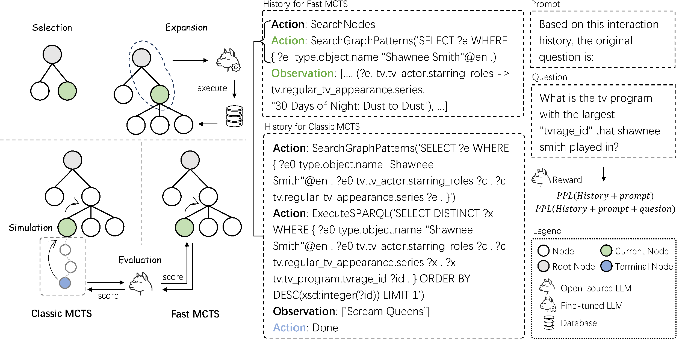

# Fast MCTS-KBQA

<p align="center">
  <a href="https://arxiv.org/abs/2502.13428"></a>
  <a href="https://dl.acm.org/doi/10.1145/3799682.3840891"></a>
</p>

**Official code for _MCTS-KBQA: Monte Carlo Tree Search with Information Gain Rewards for Knowledge Base Question Answering_ (CIKM 2026).**

Fast-MCTS-KBQA is a search-based knowledge base question answering framework that combines tool-augmented reasoning, Monte Carlo Tree Search, and information-gain rewards for efficient KBQA inference.

## Overview

Classic MCTS estimates the value of new branches through rollouts. Fast MCTS scores each new branch immediately with information gain. `ClassicMCTSKBQA` and `FastMCTSKBQA` both inherit from `KBQATreeSearch`. [Classic MCTS](search/classic_mcts.py) · [Fast MCTS](search/fast_mcts.py) · [Shared search code](search/base.py)

<p align="center">
  <picture>
    <source media="(prefers-color-scheme: dark)" srcset="img/fast_mcts_kbqa_dark.png">
    <source media="(prefers-color-scheme: light)" srcset="img/fast_mcts_kbqa_light.png">
    
  </picture>
</p>

## Setup

Use Python 3.12 and a CUDA environment compatible with [SGLang](https://docs.sglang.io/docs/get-started/install). Install SGLang first so it can select compatible versions of PyTorch and Transformers. Run the commands from the repository root.

```bash
uv pip install --upgrade sglang
uv pip install -r requirements.txt
```

Install `zstd` and `tmux`, then unpack the bundled evaluation datasets and human annotations as described in [data/readme.md](data/readme.md).

Deploy the knowledge-base tools with [Interactive-KBQA-MCP](https://github.com/JimXiongGM/Interactive-KBQA-MCP) and configure the service URLs in [config/kb.toml](config/kb.toml).

## Fine-tuning

Supply a local copy of Meta-Llama-3.1-8B-Instruct. The script trains one actor for WebQSP and CWQ together, one for GrailQA, and one for KQA Pro. Pass a dataset name to train only its actor, or omit it to train all three. If you already have an actor checkpoint, set `ACTOR_MODEL` to its local path for inference.

```bash
export BASE_MODEL=/path/to/Meta-Llama-3.1-8B-Instruct
export SFT_ROOT=save-model-sft
bash scripts/run_sft.sh "$BASE_MODEL" grailqa
```

## Fast MCTS inference and evaluation

The example uses the GrailQA actor trained above and the base model for information-gain scoring. Start the services and wait for both health checks to succeed.

```bash
export ACTOR_MODEL="$SFT_ROOT/small-GrailQA-v2/$(basename "$BASE_MODEL")-epoch5"
export REWARD_MODEL="$BASE_MODEL"
python scripts/start_sglang.py --actor_model "$ACTOR_MODEL" --reward_model "$REWARD_MODEL"

curl -fsS http://127.0.0.1:19000/ping
curl -fsS http://127.0.0.1:29000/ping
```

Run Fast MCTS on the GrailQA paper subset with its default output directory, then evaluate the saved predictions.

```bash
python -m search.fast_mcts --dataset grailqa --use_sample=True \
  --actor_model "$ACTOR_MODEL" --reward_model "$REWARD_MODEL"
python -m evaluation --dataset grailqa --use_sample=True \
  --save_dir "save-mcts/Actor-$(basename "$ACTOR_MODEL")-v1/grailqa/vote-json"
```

Use `python -m search.classic_mcts` to run the Classic MCTS baseline. The scripts [run_infer_with_reward.sh](scripts/run_infer_with_reward.sh) and [run_infer_no_reward.sh](scripts/run_infer_no_reward.sh) run the paper's search variants. Set `ACTOR_MODEL` to the model for the selected dataset. The WebQSP and CWQ paper subsets also use `--use_sample=True` for direct inference and evaluation.


## Citation

```bibtex
@inproceedings{xiong2026cikm,
  author = {Xiong, Guanming and Li, Haochen and Dai, Zonghong and Wen, Liqiang and Zhao, Wen},
  title = {MCTS-KBQA: Monte Carlo Tree Search with Information Gain Rewards for Knowledge Base Question Answering},
  year = {2026},
  isbn = {9798400725395},
  publisher = {Association for Computing Machinery},
  address = {New York, NY, USA},
  url = {https://doi.org/10.1145/3799682.3840891},
  doi = {10.1145/3799682.3840891},
  abstract = {This work investigates how to improve large language model (LLM)-based reasoning for knowledge base question answering (KBQA) via Monte Carlo Tree Search (MCTS). Applying MCTS to LLM-based KBQA remains challenging because reward design is difficult and rollout-based search is computationally expensive. Existing MCTS-style methods either rely on direct LLM scoring or require substantial data to train separate reward models, and they often provide rewards only at terminal states. To address these limitations, we propose Fast MCTS, which replaces terminal rollouts with an information gain (IG) reward for intermediate states. The IG reward is implemented as a question-conditioned PPL-ratio proxy over sanitized interaction histories, computed by forward passes of an open-source instruction LLM without additional reward-model training. Experiments on four KBQA benchmarks show that Fast MCTS consistently outperforms linear baselines and generally improves the accuracy-cost trade-off relative to rollout-based Classic MCTS.. Code and data are available at https://github.com/JimXiongGM/MCTS-KBQA.},
  booktitle = {Proceedings of the 35th ACM International Conference on Information and Knowledge Management},
  pages = {5396--5406},
  numpages = {11},
  keywords = {knowledge base question answering, monte carlo tree search, information gain reward, large language model agents},
  location = {Rome, Italy},
  series = {CIKM '26}
}
```
